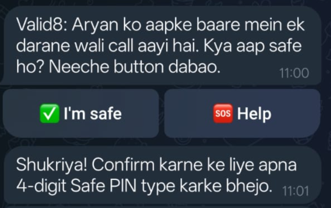
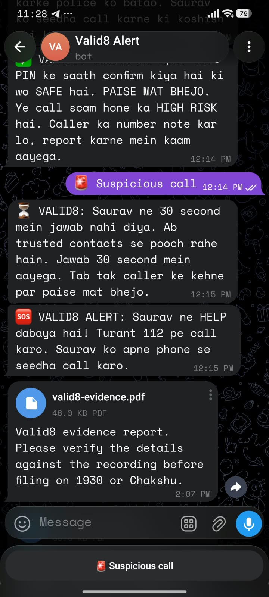
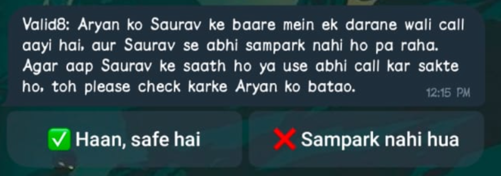
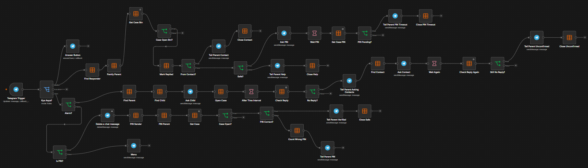
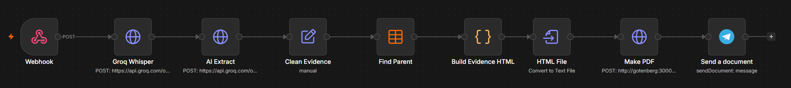
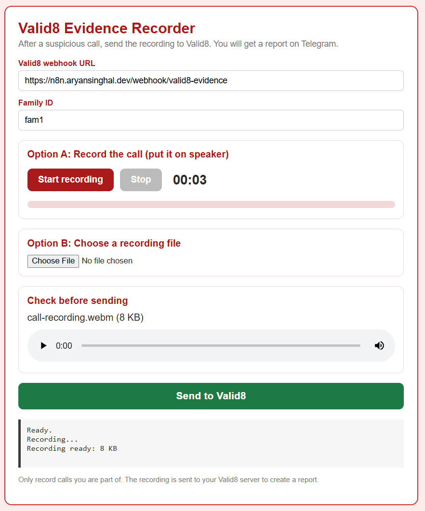
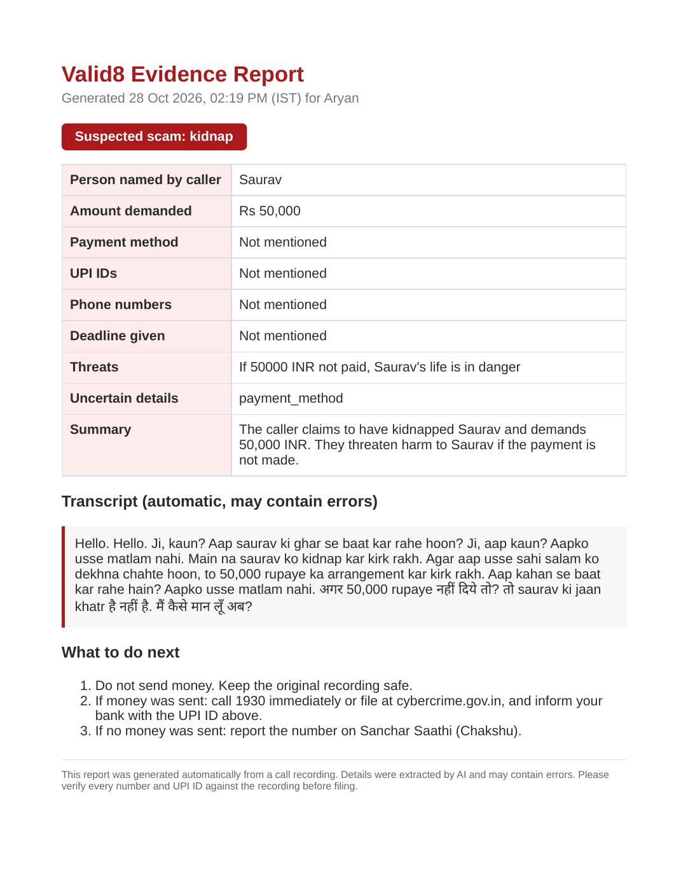
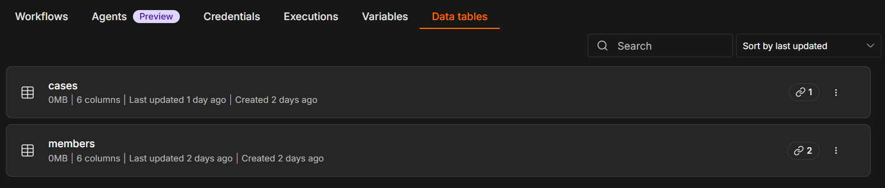

# Valid8

**One-tap verification against fake kidnapping and family-emergency scam calls.**

Team Hermes · Reforged '26 (n8n track) · Aryan Singhal, Anshu Gautam, Rohit Bora, Saurav Chakraborty

---

## The problem

Scammers clone a child's voice from a few seconds of social-media audio and call the parent: "We have your child. Don't hang up. Send money on UPI now."

Their key trick is **isolation**. While the parent stays on the line, they cannot check on the child, so they panic and pay.

## The solution

Valid8 is a Telegram bot powered by n8n. The parent stays on the call and taps **Suspicious call**. Valid8 then checks on the child in the background:

1. The child instantly gets **"Are you safe?"** with **I'm safe** and **Help** buttons.
2. If the child taps I'm safe, they confirm with a private 4-digit **Safe PIN**. The bot attempts to delete the PIN message from the chat.
3. If the child does not reply in 30 seconds, Valid8 asks the family's **trusted contacts**.
4. The parent gets a clear verdict, usually within a minute.
5. **Late replies still count.** If nobody answers in time, the parent is told UNCONFIRMED, and Valid8 keeps listening. If the child confirms or presses Help while the case remains UNCONFIRMED, the parent receives the corresponding SAFE or HELP message. The current export uses the same message wording for timely and late replies.
6. **After the call**, the family uploads a recording and Valid8 sends the parent a PDF evidence report for 1930 or Chakshu.



*Child's Telegram prompt and PIN request.*

| Verdict | When | What the parent is told |
|---|---|---|
| **SAFE** | Child sent the correct Safe PIN | Don't pay. High risk of scam |
| **HELP** | Child pressed Help | Call 112 now |
| **LOCKED** | 3 wrong PINs (phone may be with someone else) | Don't pay. Call 112 |
| **UNCONFIRMED** | No replies within the contact window, or no correct PIN within 45 seconds of I'm safe | Don't pay on the caller's word. Call 112. Replies are still accepted while the case remains UNCONFIRMED |

Valid8's **SAFE verdict** requires the child's own PIN; a trusted contact's reply is reported separately and asks the parent to confirm directly. Valid8 never says "scam confirmed".

One flow covers every scam that claims a loved one is in danger: fake kidnapping, fake arrest, accident or hospital scams, the "new number" scam, and voice-clone calls to elderly parents.

## Prototype screenshots



*Parent's view: the Suspicious call button, verification messages, and evidence report delivery.*



*Trusted contacts can report that the child is safe or that they could not make contact. Their reply does not replace the child's PIN.*

## Design decisions

- **No call interception.** Intercepting calls in India needs TRAI-compliant telephony and raises privacy concerns. Valid8 never touches the call: the parent's tap is the trigger.
- **PIN, not location, is the proof of safety.** A phone in a scammer's hands can still share a location. A PIN only the child knows cannot be shared by the phone alone.
- **No automatic location tracking.** Background tracking is a privacy compromise and needs a native app with always-on permission. A one-tap, opt-in location is planned instead (see the roadmap in Status).
- **Telegram first, WhatsApp next.** Telegram bots can message anyone who pressed Start. WhatsApp needs a verified business number and approved templates, so it is the planned production channel. The n8n logic stays the same, only the messaging node changes.
- **Honest verdicts.** If nobody confirms, Valid8 says UNCONFIRMED and points to 112. It does not guess.

## Architecture

```
Parent / Child / Trusted contacts (Telegram app)
        │
Telegram Bot API ──webhook──► Cloudflare Tunnel (HTTPS) ──► n8n (self-hosted, Docker, Azure VPS)
        ▲                                                     │
        └──────────────────── sendMessage ────────────────────┤
                                                              │
                          n8n Data Tables: members, cases     │
                                                              │
Post-call recording (web page) ──► n8n webhook ──► Groq Whisper + LLM ──► Gotenberg (PDF) ──► Telegram
```

During the call, no audio is processed. Audio is used only after the call, when the family uploads a recording.

## n8n workflow 1: `Valid8 - Bot Router` (during the call)

```
Telegram Trigger → Kya Aaya? (Switch)
  ├─ Text  → Alarm? ─ true  → Find Parent → Find Child → Ask Child → Open Case
  │                   │        → After Time Interval (30s) → Check Reply → No Reply?
  │                   │        → Tell Parent Asking Contacts → Find Contact → Ask Contact
  │                   │        → Wait Again (30s) → Check Reply Again → Still No Reply?
  │                   │        → Tell Parent Unconfirmed → Close Unconfirmed (status = unconfirmed)
  │                   └ false → Is PIN? ─ true  → Delete a chat message → PIN Sender → PIN Parent
  │                                      │        → Get Case → Case Open? (open or unconfirmed) → PIN Correct?
  │                                      │           ├ true  → Tell Parent Verified → Close Safe
  │                                      │           └ false → Count Wrong PIN → Tell Parent PIN
  │                                      └ false → Menu (shows the Suspicious call button)
  └─ Button → Answer Button (acknowledges the callback)
            + Find Responder → Family Parent → Get Case Btn → Case Open Btn? (open or unconfirmed)
            → Mark Replied → From Contact?
                 ├ true  → Tell Parent Contact → Close Contact
                 └ false → Safe? ─ true  → Ask PIN → Wait PIN (45s) → Get Case PIN → PIN Pending?
                                  │                 → Tell Parent PIN Timeout → Close PIN Timeout (status = unconfirmed)
                                  └ false → Tell Parent Help → Close Help
```



*Full Bot Router canvas. [Open the full-size screenshot](docs/screenshots/bot-router-workflow.png) to inspect node labels.*

## n8n workflow 2: `Valid8 - Evidence` (after the call)

```
Webhook (recording + familyId) → Groq Whisper → AI Extract → Clean Evidence
  → Find Parent → Build Evidence HTML → HTML File → Make PDF (Gotenberg) → Send a document (Telegram)
```

- **Web page:** [valid8-evidence.html](valid8-evidence.html) captures microphone audio or uploads an existing recording, then posts multipart `audio` to the webhook with `familyId` in the query string. The prototype is served over HTTPS with GitHub Pages for microphone access. Speaker audio can be captured on another device; same-phone recording during a call depends on the phone and browser.
- **Extraction:** the AI pulls out the amount, UPI IDs, phone numbers, deadline and threats, and flags uncertain details.
- **Safety:** transcripts and numbers can be misheard, so the report tells the family to verify every number and UPI ID against the recording before filing. Valid8 never files anything by itself.





*Record or upload audio, preview it, and send it to the configured Valid8 server.*



*Report generated from a test recording. [Open the example PDF](valid8-example-evidence.pdf).*

## Data tables



The screenshot shows table names only. The schemas below document the fields used by the workflows; n8n also manages row metadata.

**`members`**

| Column | Type | Example |
|---|---|---|
| `chatId` | String | Telegram chat ID |
| `name` | String | Saurav |
| `role` | String | `parent`, `child` or `contact` |
| `familyId` | String | `fam1` |
| `pin` | String | 4-digit Safe PIN (child only) |

**`cases`**

| Column | Type | Values |
|---|---|---|
| `familyId` | String | `fam1` |
| `status` | String | `open`, `unconfirmed`, `safe`, `help`, `locked`, `contact_safe`, `contact_no` |
| `startedAt` | String | ISO timestamp |
| `attempts` | Number | Wrong PIN count |
| `replied` | String | `yes` / `no` |

## Setup

1. Run n8n in Docker with a public HTTPS URL (we use a Cloudflare Tunnel) and set `WEBHOOK_URL` to it.
2. Create a Telegram bot with @BotFather and add it as a Telegram credential in n8n.
3. Create the `members` and `cases` data tables shown above.
4. Import `workflows/valid8-bot-router.json`, then re-select the credential and both data tables in each node.
5. Publish the workflow. Every family member presses **Start** on the bot once.
6. Add one row per person to `members` (same `familyId`, correct `role`, and a PIN for the child).
7. **Evidence workflow:** run Gotenberg (`gotenberg/gotenberg:8`) on the same Docker network as n8n, add a Groq API key as a Header Auth credential (`Authorization: Bearer ...`), and import `workflows/valid8-evidence.json`.
8. In the evidence workflow, re-select the `members` data table in **Find Parent**, the Groq Header Auth credential in both **Groq Whisper** and **AI Extract**, and the Telegram credential in **Send a document**, then publish the workflow. The exported PDF endpoint is `http://gotenberg:3000/forms/chromium/convert/html`; adjust it if your container service has a different name.
9. Serve [valid8-evidence.html](valid8-evidence.html) over HTTPS (for example, GitHub Pages). Set the page's webhook URL to `https://<your-n8n-host>/webhook/valid8-evidence` and enter the family's `familyId`. The committed page contains the team's demo endpoint and `fam1`; replace those defaults for your deployment.
10. Run a test with a consenting family member: start a case, confirm with the child's PIN, and separately upload a test recording to check PDF delivery. An HTTP success in the recorder means the upload was accepted; it does not confirm that the report has been delivered.

### Repository contents

| File or directory | Purpose |
|---|---|
| [workflows/valid8-bot-router.json](workflows/valid8-bot-router.json) | Importable live verification workflow |
| [workflows/valid8-evidence.json](workflows/valid8-evidence.json) | Importable post-call evidence workflow |
| [valid8-evidence.html](valid8-evidence.html) | Evidence recorder and upload page |
| [index.html](index.html) | GitHub Pages entry page that redirects the site root to the evidence recorder |
| [docs/screenshots/](docs/screenshots/) | Prototype screenshots and sample report preview |
| [valid8-example-evidence.pdf](valid8-example-evidence.pdf) | Example evidence report from a test recording |
| [Valid8-Hermes-ppt.pdf](Valid8-Hermes-ppt.pdf) | Team Hermes presentation |
| [LICENSE](LICENSE) | MIT license |

## Status

| Prototype features | Roadmap |
|---|---|
| Suspicious call → child popup | WhatsApp Cloud API channel (same n8n logic) |
| Safe PIN check, PIN message deletion attempted | One-tap, opt-in location after a correct PIN |
| Help alert | SMS fallback for trusted contacts |
| 3 wrong PINs → LOCKED | Self-service onboarding with invite links |
| Trusted contacts after 30 s | Hashed PIN storage |
| UNCONFIRMED verdict and late replies forwarded to the parent | Listening window that expires after a set time |
| Button replies ignored while the case has a final status | Atomic counter for PIN attempts |
| Post-call evidence: recording → transcript → AI extraction → PDF on Telegram | |

## Known limitations

- PINs are stored in plain text in the prototype. Production will store a hash.
- Very fast repeated PIN attempts can race the counter. Production needs an atomic counter.
- In the prototype, UNCONFIRMED keeps listening with no expiry. Production will close the case after a set window.
- A late wrong PIN can change an UNCONFIRMED case back to `open`. That can affect timeout handling and needs to be tidied.
- Valid8 needs the child and contacts to have joined the bot. Missing member/contact rows or failed sends can stop a branch before an UNCONFIRMED message; setup must include those rows.
- Callbacks and waiting executions are associated with `familyId`, without a unique case ID. Old buttons and timers can affect a new case. Avoid overlapping checks in the prototype; production needs case-specific callbacks and timer guards.
- A trusted contact's answer closes the case as `contact_safe` or `contact_no`, so further child/contact replies are ignored until a new case opens.
- PIN validation relies on the setup convention that only child rows contain PINs; the sender lookup does not explicitly filter by child role. Deleting a PIN message is best effort and does not remove it from n8n execution data.
- The evidence webhook is unauthenticated in the export, trusts the supplied `familyId`, and allows all origins. Production needs authenticated uploads, family authorization, and an origin allowlist.
- The recorder's 24 MB check applies to uploaded files, not microphone recordings. Upload acceptance does not guarantee transcription, PDF generation, or Telegram delivery.
- A correct PIN confirms the child is safe. It does not by itself prove who the caller is.
- The evidence report depends on speech-to-text, which can mishear UPI IDs and phone numbers. Recordings are sent to a third-party API (Groq) only when the family uploads one.

The feature list reflects the supplied prototype and demo assets. Import and test both workflows against your own credentials and data tables before relying on them.

## Emergency numbers (India)

- **112**: single emergency number
- **1930** or [cybercrime.gov.in](https://cybercrime.gov.in/): report financial fraud
- **[Sanchar Saathi (Chakshu)](https://sancharsaathi.gov.in/sfc/)**: report suspected fraud calls

## Built with

n8n · Telegram Bot API · Docker · Cloudflare Tunnel · Groq (Whisper large-v3, gpt-oss-120b) · Gotenberg
